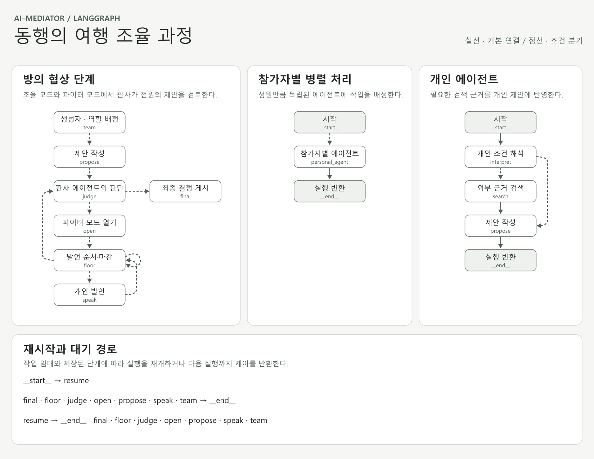

# 동행 · AI 여행 조율

[동행 웹앱 열기](https://iisd-travel-mediator-bogc.onrender.com) · [v1.0.0 릴리스](https://github.com/IISD-AI-mediator/AI-Mediator/releases/tag/v1.0.0)

여행을 함께 갈 사람들이 예산과 일정, 꼭 지키고 싶은 조건을 각자의 에이전트에게 맡기는 웹앱이다. 방장이 확정한 항공편은 그대로 두고, 숙소 위치나 현지 교통처럼 아직 열려 있는 선택지를 함께 조율할 수 있다. 중앙대학교 Interactive Intelligent System Design 팀 프로젝트로 개발했다.

## 여행방 사용 방법

1. 첫 화면에서 **여행방 만들기**를 누르고 닉네임과 방장을 포함한 인원(2~8명)을 정한다. 이미 정한 항목을 입력하고 나머지는 에이전트에게 맡긴다. 방 전체를 진행할 중재자의 말투도 이때 설정한다.
2. 방장이 **초대 링크 복사**로 팀원에게 `/r/<초대 코드>` 주소를 보낸다. 방장도 다른 참가자처럼 자신의 여행 조건·중요도와 개인 에이전트의 성격을 제출한다. 개인 에이전트와 중재자의 성격은 독립적이다.
3. 정원이 차고 전원이 **준비 완료**하면 각자의 에이전트가 제안을 만든다. 식당이나 교통편에 외부 확인이 필요하면 검색한 근거와 조회 시각을 남긴다.
4. 의견이 모이면 결과로 이동한다. 의견이 갈리면 **파이트 모드**에서 에이전트들의 단체 대화가 열린다. 사용자는 자기 에이전트에 추가 지시를 보낼 수 있다. 결정자는 앞선 결정을 수정할 수 있고, 양립할 수 없는 필수 조건은 결과에 미합의로 남긴다.

배포된 앱에서 새 방을 만들 때는 팀 개설 코드가 필요하다. 운영자는 Render Dashboard에서 웹 서비스를 선택한 뒤 **Environment → ROOM_CREATE_CODE**에서 확인해 방장에게 전달한다. 초대받은 사람은 초대 링크와 닉네임으로 참여한다.

## Windows에서 실행

Anaconda PowerShell Prompt에서 저장소 루트로 이동한 뒤 실행한다. 처음 한 번 환경을 생성한다.

```powershell
git switch feat/jskim
conda env create -f environment.yml
conda activate iisd
python --version
```

이미 `iisd` 환경이 있으면 `conda activate iisd` 후 `python -m pip install -r requirements.txt`로 의존성을 맞춘다. Python 버전은 `3.13.x`다. 아래 명령은 키를 화면이나 셸 기록에 표시하지 않고 현재 PowerShell 프로세스에만 전달한다.

```powershell
$geminiInput = Read-Host "Gemini API key" -AsSecureString
$env:GEMINI_API_KEY = [System.Net.NetworkCredential]::new('', $geminiInput).Password
python -m travel_app
```

PC에서 `http://127.0.0.1:8000`을 연다. 두 참가자를 시험할 때는 일반 브라우저와 시크릿 창처럼 쿠키가 분리된 창을 사용한다. 같은 브라우저에서 새로고침하면 같은 참가자로 복귀한다. 로컬 데이터는 `instance/travel.sqlite3`에 저장된다. Windows에서 Docker나 MySQL을 시작할 필요가 없다. [환경변수 이름](.env.example)

## 구조

| 구성 요소 | 담당하는 일 |
| --- | --- |
| 브라우저 · HTML/CSS/JavaScript | 홈, 방 만들기, 초대, 개인 입력, 준비 현황, 단체 대화와 결과를 표시한다. 동일 출처 JSON API를 주기적으로 조회해 다른 참가자의 상태와 발언을 반영한다. |
| Flask · Waitress | 참가자를 방별 쿠키로 식별하고 입력 검증과 요청 처리를 담당한다. Waitress가 Windows와 호스팅에서 같은 Flask 앱을 실행한다. |
| SQLite · PostgreSQL | 방, 개인별 입력, 발언, 잠정 결정, 최종 결정, 진행 중인 작업을 저장한다. 로컬 기본값은 SQLite, Render의 지속 저장소는 PostgreSQL이다. |
| LangGraph · Gemini | 생성자는 확정 정보를 토대로 역할을 배정한다. 개인 조율자는 자신의 요구를 검토하는 서브그래프에서 필요할 때 검색을 요청한다. 결정자는 다른 모델로 제안과 근거를 비교하고, 합의 여부에 따라 다음 단계를 결정한다. |

개인 조율과 검색에는 `gemini-3.1-flash-lite`, 결정에는 `gemini-3.8-flash`를 사용한다. Google Search grounding이 반환한 출처를 검색 결과와 연결한다. 항공 운임은 노선·날짜·시간대·통화·운임 조건이 맞는 출처를 확인한 경우에만 관찰 가격으로 표시한다. 판매처 전체를 망라하는 실시간 최저가나 예약을 보장하지 않는다. [검색 API](https://ai.google.dev/gemini-api/docs/google-search)



그래프가 바뀌면 `python docs/langraph/export_graph.py`로 SVG를 다시 만든다. Inkscape 또는 CairoSVG가 설치된 환경에서는 `python docs/langraph/export_graph.py --png`로 PNG도 생성한다. [확대 가능한 그래프](docs/langraph/travel-graph.svg)

| 경로 | 내용 |
| --- | --- |
| `travel_app/__init__.py`, `__main__.py`, `wsgi.py` | HTTP API, 로컬 실행, 배포 진입점 |
| `travel_app/domain.py`, `store.py`, `runner.py` | 공통 여행 항목, 저장·권한, 미완료 작업 재개 |
| `travel_app/graph.py`, `agents.py`, `decisions.py`, `models.py` | 방 그래프, 개인·검색 에이전트, 결정 검증, Gemini 호출 |
| `travel_app/templates/`, `travel_app/static/` | 한국어 화면, 입력 폼, 채팅, 스타일 |
| `docs/langraph/` | 실행 그래프에서 생성한 SVG·PNG와 재생성 스크립트 |
| `docs/design/`, `docs/adr/`, `docs/implementation/`, `docs/test/` | 화면 흐름, 아키텍처 결정, 기능 기준, 검증 기록 |
| `plugins/french-toast/` | GitHub 마켓플레이스의 French Toast 1.1.1 개발 워크플로 |
| `environment.yml`, `requirements.txt`, `render.yaml` | Conda 환경, Python 의존성, 호스팅 구성 |

## 팀 테스트 비용

4명이 한 여행방을 끝까지 사용하는 것을 1회로 놓고 20회를 가정했다. Render 무료 웹 서비스와 무료 PostgreSQL의 해당 사용 한도 안에서 호스팅·DB 요금은 **$0**이다. 무료 서버는 15분간 요청이 없으면 잠들고 첫 요청 시 깨어난다. 무료 PostgreSQL은 만든 날부터 30일 뒤 만료된다. [Render 무료 플랜](https://render.com/docs/free)

Render Hobby의 기본 빌드 파이프라인 제공량은 월 500분이다. 3분 걸리는 배포를 10번 하면 약 30분을 사용한다. 팀원이 이미 배포한 링크에서 여행방을 이용하는 횟수는 배포 횟수에 포함되지 않는다. [빌드 시간과 한도](https://render.com/docs/build-pipeline)

2026년 11월 단가로 아래의 유료 Gemini 사용량을 가정하면 **20회 합계 약 $0.25~$1.25**다. 모델 과금용 출력 토큰에는 추론 토큰도 포함한다. 실제 토큰 수, 재시도, 파이트 횟수에 따라 달라진다.

| 모델 | 여행방당 호출 가정 | 호출당 입력/출력 가정 | 입력/출력 100만 토큰 단가 |
| --- | --- | --- | --- |
| 3.1 Flash-Lite | 12~24회 | 1,200~2,000 / 250~550 | $0.25 / $1.50 |
| 3.8 Flash | 1~3회 | 3,000~6,000 / 600~1,500 | $0.75 / $3.75 |

텍스트 모델의 무료 할당량만 사용하면 모델 토큰 과금은 $0일 수 있다. 기본 Google Search grounding은 두 모델의 일반 무료 등급에서 제공되지 않는다. 실검색까지 시험할 때는 해당 기능을 사용할 수 있는 Google 프로젝트가 필요하다. 유료 등급은 지원 모델을 합산해 월 5,000개 검색 쿼리가 기본 포함되며 초과분은 1,000개당 $14다. 위 추정은 포함량이 남아 있는 경우다. [Gemini 공식 요금](https://ai.google.dev/gemini-api/docs/pricing)

## 팀

Team Whisper Rabbit · 중앙대학교 예술공학부

| 역할 | 팀원 |
| --- | --- |
| 프로젝트 매니저 | Unjeong Kim |
| 프로덕트 매니저 | Kiuk Kim, Suyeon Kwon |
| 개발 | Jinseo Kim, Jieun Jeong, Harin Hwang |
